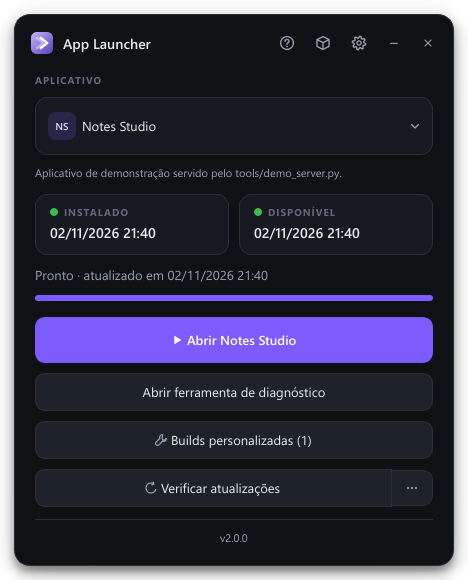
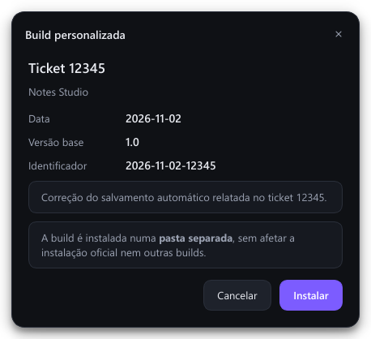
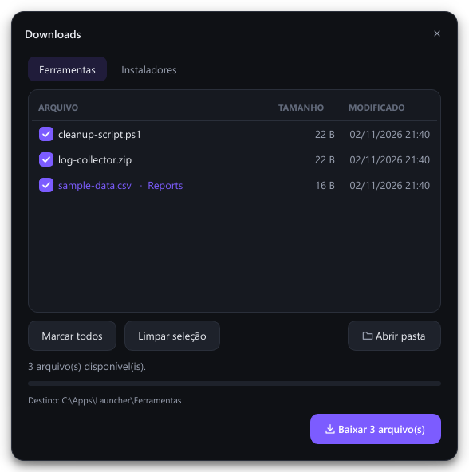
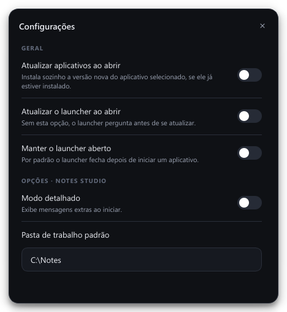

# App Launcher

Launcher para Windows que **instala, atualiza e executa aplicativos** distribuídos por um servidor FTP/FTPS. Tudo o que é específico de um ambiente — servidor, aplicativos, opções, login, downloads avulsos — fica num único `launcher_config.json`, então o mesmo executável serve para qualquer conjunto de aplicativos.

Feito em Python + PyQt6, com interface escura, cor de destaque configurável e todo o trabalho de rede fora da thread da interface.

<p align="center">
  
  
</p>

## Funcionalidades

- **Vários aplicativos** num seletor, cada um com pasta, pacote e executável próprios.
- **Instalação e atualização** a partir do servidor, comparando data (`MDTM`) e tamanho (`SIZE`) do pacote publicado com a versão instalada; painel "Instalado / Disponível" com indicador de status.
- **Download seguro**: grava em `.part`, confere o tamanho e — se existir `<pacote>.sha256` ao lado do arquivo no servidor — o hash SHA-256 antes de instalar. A extração bloqueia *Zip Slip* (entradas fora da pasta de destino).
- **FTP ou FTPS** (TLS explícito), com credenciais na configuração, cifradas (`password_enc`) ou buscadas de uma URL remota com cache local.
- **Atualização automática** do aplicativo selecionado e do próprio launcher (troca do `.exe` via script, com verificação na reabertura).
- **Opções por aplicativo** declaradas na configuração (liga/desliga, texto ou senha) que viram variáveis de ambiente do processo iniciado.
- **Ações extras**: botões para outros executáveis do mesmo pacote.
- **Builds personalizadas por ticket**: o suporte publica uma versão específica para um chamado; o usuário digita o código e ela é instalada numa pasta isolada, sem tocar na instalação oficial. Arquivos do usuário (ex.: configurações) podem ser copiados da instalação oficial.
- **Downloads avulsos** em abas (ferramentas, instaladores…), com seleção múltipla.
- **Login opcional** via HTTP, com "lembrar dados" e entrada automática.
- **Verificar integridade**, **abrir pasta de instalação** e **desinstalar**.

<p align="center">
  
  
</p>

## Começando

Requer Windows e Python 3.11+.

```bash
python -m venv .venv
.venv\Scripts\activate
pip install -r requirements-dev.txt
```

Para ver tudo funcionando sem um servidor real, suba o servidor de demonstração num terminal:

```bash
python -m tools.demo_server
```

E abra o launcher em outro:

```bash
python -m launcher
```

Sem um `launcher_config.json`, o launcher usa o [`launcher_config.example.json`](launcher_config.example.json), que aponta para o servidor de demonstração. Para simular uma versão nova publicada, reinicie o servidor com `python -m tools.demo_server --bump`. O código `12345` instala a build personalizada de exemplo.

## Configuração

Copie `launcher_config.example.json` para `launcher_config.json` (na pasta do `Launcher.exe`, ou na raiz do projeto ao rodar pelo Python) e ajuste. Também é possível apontar outro arquivo com `--config caminho.json`.

| Chave | Descrição |
|---|---|
| `app_name`, `app_id` | Nome exibido e identificador usado na pasta de estado (`%LOCALAPPDATA%\<app_id>`). |
| `accent_color` | Cor de destaque da interface (`#RRGGBB`). |
| `support_url` | Página aberta em *Ajuda → Reportar um problema*. |
| `server` | `protocol` (`ftp`/`ftps`), `host`, `port`, `user`, `password` **ou** `password_enc` + `secret`, `credentials_url`, `encoding`, `timeout`. |
| `auth` | `type: "none"` ou `"http"` (`url`, `title`, `user_label`, `success_contains`, `session_env`). |
| `self_update` | `remote_dir` e `file_name` do `Launcher.exe` publicado. |
| `apps[]` | Ver abaixo. |
| `downloads[]` | Abas de downloads: `label`, `remote_dir`, `destination`, `extra_files[]` (`name`, `remote_dir`, `badge`). |

Cada item de `apps`:

```json
{
  "id": "notes",
  "name": "Notes Studio",
  "description": "Texto curto exibido abaixo do seletor.",
  "remote_dir": "/apps/notes",
  "package": "notes.zip",
  "install_dir": "Notes Studio",
  "executable": "notes.exe",
  "env": { "NOTES_LAUNCHED_BY": "app-launcher" },
  "extra_actions": [{ "label": "Abrir diagnóstico", "executable": "diagnostics.exe" }],
  "options": [
    { "key": "verbose", "label": "Modo detalhado", "type": "bool", "env": "NOTES_VERBOSE" },
    { "key": "token", "label": "Token da API", "type": "password", "env": "NOTES_TOKEN" }
  ],
  "custom_builds": {
    "remote_subdir": "custom-builds",
    "code_label": "Ticket",
    "code_pattern": "^\\d{5}$",
    "package_names": ["build.zip", "dist.zip"],
    "carry_over_files": ["settings.ini"]
  }
}
```

Opções `bool` ligadas viram `"1"` e desligadas removem a variável; opções de texto vazias também removem a variável, para o aplicativo nunca herdar um valor antigo do ambiente. Opções `password` são guardadas cifradas.

### Login HTTP

Com `auth.type = "http"`, o launcher envia `POST {"username": ..., "password": ...}` para `auth.url`. A resposta é aceita quando é 2xx e (se `success_contains` estiver definido) contém aquele texto; 401/403 contam como credenciais inválidas. `session_env` repassa usuário e senha ao aplicativo iniciado:

```json
"auth": {
  "type": "http",
  "url": "https://auth.example.com/login",
  "session_env": { "user": "APP_USER", "password": "APP_PASSWORD" }
}
```

### Senha cifrada e credenciais remotas

Para não deixar a senha do servidor em texto puro:

```bash
python -m tools.encrypt_password --new-secret
```

O comando imprime o `secret` (vai em `server.secret`) e o `password_enc`. O esquema (PBKDF2-HMAC-SHA256 + keystream SHA-256 + HMAC, só stdlib) está descrito em [`launcher/crypto.py`](launcher/crypto.py). É ofuscação com integridade: protege um JSON acessível por link, mas quem tem o `secret` consegue decifrar.

Com `server.credentials_url`, as credenciais (`host`, `port`, `user`, `password`/`password_enc`) vêm de um JSON remoto a cada conexão; trocar a senha do servidor não exige redistribuir o launcher. A última resposta válida fica em cache, cifrada com a DPAPI do Windows, para o launcher continuar funcionando se a URL ficar fora do ar.

## Estrutura no servidor

```
/apps/notes/
    notes.zip                 ← pacote oficial (package)
    notes.zip.sha256          ← opcional: hash verificado no download
    custom-builds/
        12345/                ← código do ticket
            build.zip         ← primeiro nome de package_names encontrado
            info.json         ← opcional: id, description, base_version, date
/launcher/
    Launcher.exe              ← publicado para a auto-atualização
```

Para gerar o `.sha256`: `certutil -hashfile notes.zip SHA256` ou `sha256sum notes.zip > notes.zip.sha256`.

## Onde ficam os dados

- **Aplicativos instalados**: na pasta do launcher (`<install_dir>`); builds personalizadas em `<install_dir> - build <código>`.
- **Estado** (preferências, versões instaladas, opções): `%LOCALAPPDATA%\<app_id>\state.json`. Senha lembrada, opções do tipo senha e credenciais em cache ficam cifradas com DPAPI — só o mesmo usuário do Windows consegue lê-las.

## Arquitetura

```
launcher/
  config.py        leitura e validação do launcher_config.json
  remote.py        FTP/FTPS, credenciais, listagem, download com verificação
  installer.py     extração segura, builds isoladas, ambiente de execução
  auth.py          login opcional e credenciais lembradas
  self_update.py   troca do próprio .exe
  state.py         estado em JSON + DPAPI
  crypto.py        cifra do password_enc
  ui/              janelas (PyQt6): tema, ícones desenhados em código, diálogos
tools/             servidor de demonstração, gerador de ícone e de senha cifrada
tests/             testes unitários e de integração (servidor FTP real em thread)
```

Os módulos fora de `ui/` não dependem de Qt e são cobertos pelos testes. Na interface, toda operação de rede roda em `QThread` (`ui/widgets.py: Task`), então a janela nunca congela durante downloads.

## Testes

```bash
python -m unittest discover -s tests -v
```

A suíte roda no GitHub Actions (`windows-latest`) a cada push e pull request.

## Build do executável

```bash
build.bat
```

Gera `dist\Launcher.exe` com PyInstaller (`Launcher.spec`). Distribua o `.exe` junto com o seu `launcher_config.json`. O ícone (`assets/app.ico`) é gerado a partir da marca desenhada em código: `python -m tools.make_icon --accent "#7C5CFF"`.

Para a auto-atualização funcionar, publique o novo `Launcher.exe` em `self_update.remote_dir` usando transferência **binária** — o modo ASCII altera o tamanho do arquivo e as máquinas nunca reconhecem a versão como instalada.

## Licença

[MIT](LICENSE)
