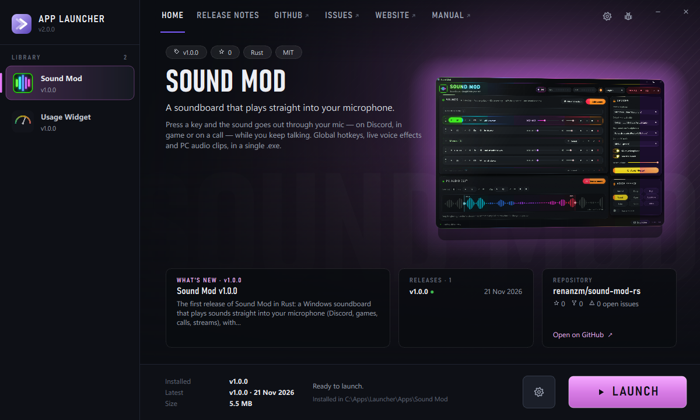
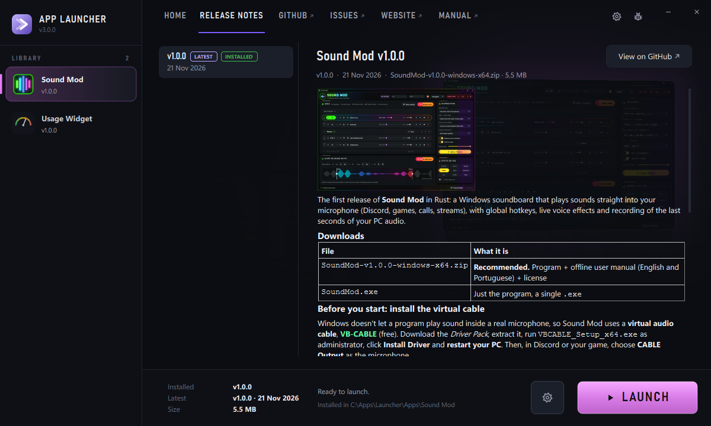
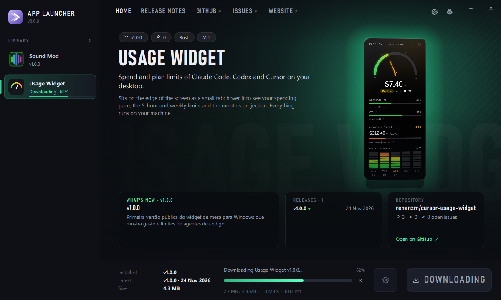

# App Launcher

**English** · [Português (Brasil)](README.pt-BR.md)

A Windows launcher, in the style of a game launcher, that **installs, updates and runs applications published as GitHub releases** — or distributed over FTP/FTPS. Everything environment-specific — which apps, where they come from, options, login — lives in a single `launcher_config.json`, so the same executable works for any set of applications.

Built with Python + PyQt6: a library of apps on the left, each app's artwork and release notes in the middle, a big launch button at the bottom, and all network work kept off the UI thread. The interface is available in **English** and **Brazilian Portuguese**.

<p align="center">
  
</p>

## Features

- **GitHub releases as the source**: point an app at `owner/repo` and the launcher finds the latest release, picks the Windows asset (a `.zip` or a single `.exe`), downloads it and installs it. New releases show up as updates on their own.
- **Safe downloads**: written to a `.part` file and checked against the size and the **SHA-256 digest GitHub publishes** for each asset before anything is installed. Zip extraction blocks *Zip Slip*, and a zip whose files sit inside one top-level folder is flattened.
- **Game-launcher interface**: app library with real icons (taken from the installed `.exe`), a header with the app's banner or a backdrop generated from its accent colour plus its screenshot, cards with what's new, recent releases and repository stats, a **release notes** page that renders the Markdown (images included), and links to GitHub, issues and the project's website.
- **Bilingual release notes**: when the notes are written in English and Portuguese, only the part in the interface language is shown.
- **Progress like a store**: percentage, MB downloaded, speed and time left; downloads can be cancelled.
- **Updates**: of every installed app on startup (optional) and of the launcher itself, from its own GitHub releases. Checks use conditional requests (ETag), so they barely touch the API limit, and keep working offline with the last data seen.
- **Per-application options** declared in the configuration (toggle, text or password) that become environment variables of the launched process; **extra actions** for other executables in the package.
- **FTP or FTPS** still supported, per app, with encrypted or remote credentials, plus standalone downloads in tabs.
- **Optional HTTP login**, with "remember me" and automatic sign-in.
- **Verify integrity**, **open install folder** and **uninstall**.
- **Native window** on Windows 11: shadow, rounded corners and snap, with no title bar.
- **English and Portuguese (Brazil)** interface, following the system language or chosen in Settings.

<p align="center">
  
  
</p>

## Getting started

Requires Windows and Python 3.11+.

```bash
python -m venv .venv
.venv\Scripts\activate
pip install -r requirements-dev.txt
python -m launcher
```

Without a `launcher_config.json`, the launcher uses [`launcher_config.example.json`](launcher_config.example.json), which lists apps published on GitHub ([Sound Mod](https://github.com/renanzm/sound-mod-rs) and [Usage Widget](https://github.com/renanzm/cursor-usage-widget)). Apps are installed in the `Apps` folder next to the launcher.

To try the FTP mode without a real server, start the demo server in one terminal and open the launcher with the demo configuration in another:

```bash
python -m tools.demo_server
python -m launcher --config tools/demo_config.json
```

Restart the server with `python -m tools.demo_server --bump` to simulate a newly published version.

## Language

The interface language is picked in this order:

1. the `--lang` command-line flag (`en` or `pt-BR`);
2. the **Language** option in *Settings* (takes effect on the next start);
3. the `language` key in `launcher_config.json`;
4. the operating system language, falling back to English.

Adding another language means adding a catalogue in [`launcher/locales/`](launcher/locales) that maps each English text to its translation (see [`pt_br.py`](launcher/locales/pt_br.py)) and registering it in `LANGUAGES` in [`launcher/i18n.py`](launcher/i18n.py). A test fails if a string in the code has no translation, or if a catalogue entry is no longer used.

## Configuration

Copy `launcher_config.example.json` to `launcher_config.json` (next to `Launcher.exe`, or in the project root when running from Python) and adjust it. You can also point to another file with `--config path.json`.

| Key | Description |
|---|---|
| `app_name`, `app_id` | Display name and the identifier used for the state folder (`%LOCALAPPDATA%\<app_id>`). |
| `accent_color` | Interface accent colour (`#RRGGBB`). |
| `language` | `auto` (default), `en` or `pt-BR`. |
| `install_root` | Folder for installed apps: relative to the launcher, absolute, or with environment variables (`%LOCALAPPDATA%\MyApps`). Default: the launcher folder. |
| `support_url` | Page opened by the *Report a bug* button (hidden when empty). |
| `github` | Optional: `token` (private repositories or a higher rate limit) and `timeout`. |
| `self_update` | `github` (`owner/repo` whose releases carry the launcher) **or** `remote_dir` (FTP), plus `file_name` (default `Launcher.exe`). |
| `server` | FTP only: `protocol` (`ftp`/`ftps`), `host`, `port`, `user`, `password` **or** `password_enc` + `secret`, `credentials_url`, `encoding`, `timeout`. |
| `auth` | `type: "none"` or `"http"` (`url`, `title`, `user_label`, `success_contains`, `session_env`). |
| `apps[]` | See below. |
| `downloads[]` | FTP download tabs: `label`, `remote_dir`, `destination`, `extra_files[]` (`name`, `remote_dir`, `badge`). |

### Apps from GitHub

```json
{
  "id": "sound-mod",
  "name": "Sound Mod",
  "github": "renanzm/sound-mod-rs",
  "asset": "SoundMod-*-windows-x64.zip",
  "executable": "SoundMod.exe",
  "accent_color": "#E879F9",
  "tagline": { "en": "A soundboard that plays straight into your microphone.", "pt-BR": "Soundboard que toca direto no seu microfone." },
  "description": "Shown in the header; defaults to the repository description.",
  "screenshot": "https://raw.githubusercontent.com/renanzm/sound-mod-rs/master/docs/screenshot.png",
  "links": [{ "label": "Manual", "url": "https://github.com/renanzm/sound-mod-rs/blob/master/docs/MANUAL.md" }]
}
```

| Key | Description |
|---|---|
| `github` | `owner/repo` (a full `https://github.com/...` URL also works). |
| `asset` | Glob of the release file to install (`*.exe`, `MyApp-*-win64.zip`). Without it, the launcher picks the most likely portable Windows build and skips installers and other platforms. |
| `executable` | The `.exe` to launch, inside the install folder. Optional: for a single-`.exe` asset it is the asset itself; for a `.zip`, the launcher finds the executable whose name looks like the app's. |
| `prerelease` | `true` also offers pre-releases. |
| `install_dir` | Folder inside `install_root` (default: `name`). |
| `accent_color` | The app's own colour (header, button, progress). |
| `tagline`, `description` | Header texts. |
| `banner` | Image that fills the header. Without it, the header is generated from `accent_color`. |
| `screenshot` | Image shown framed in the header (ignored when there is a `banner`). |
| `icon` | Library icon. Without it, the icon of the installed `.exe` is used, or the app's initials. |
| `links[]` | Extra links in the top bar (`label`, `url`), after GitHub, Issues and the repository's website. |

`tagline`, `description`, `banner`, `screenshot` and link labels may be a text or an object of translations (`{"en": ..., "pt-BR": ...}`). Images may be URLs (downloaded once and cached) or paths relative to the configuration file.

Updating an app extracts the new package over the install folder, so files the app keeps there are preserved. If the app is running, the launcher asks you to close it first.

### Apps from FTP

```json
{
  "id": "notes",
  "name": "Notes Studio",
  "remote_dir": "/apps/notes",
  "package": "notes.zip",
  "executable": "notes.exe",
  "env": { "NOTES_LAUNCHED_BY": "app-launcher" },
  "extra_actions": [{ "label": "Open diagnostics", "executable": "diagnostics.exe" }],
  "options": [
    { "key": "verbose", "label": "Verbose mode", "type": "bool", "env": "NOTES_VERBOSE" },
    { "key": "token", "label": "API token", "type": "password", "env": "NOTES_TOKEN" }
  ]
}
```

The version is the date (`MDTM`) and size (`SIZE`) of the package; a `<package>.sha256` next to it is checked on download. `env`, `extra_actions` and `options` work for GitHub apps too.

A `bool` option that is on becomes `"1"`, and one that is off removes the variable; an empty text option also removes the variable, so the application never inherits a stale value from the environment. `password` options are stored encrypted.

### HTTP login

With `auth.type = "http"`, the launcher sends `POST {"username": ..., "password": ...}` to `auth.url`. The response is accepted when it is 2xx and (if `success_contains` is set) contains that text; 401/403 count as invalid credentials. `session_env` passes the user and password on to the launched application:

```json
"auth": {
  "type": "http",
  "url": "https://auth.example.com/login",
  "session_env": { "user": "APP_USER", "password": "APP_PASSWORD" }
}
```

### Encrypted password and remote credentials (FTP)

To avoid leaving the server password in plain text:

```bash
python -m tools.encrypt_password --new-secret
```

The command prints the `secret` (goes in `server.secret`) and the `password_enc`. The scheme (PBKDF2-HMAC-SHA256 + SHA-256 keystream + HMAC, stdlib only) is described in [`launcher/crypto.py`](launcher/crypto.py). It is obfuscation with integrity: it protects a JSON reachable by link, but anyone holding the `secret` can decrypt it.

With `server.credentials_url`, the credentials (`host`, `port`, `user`, `password`/`password_enc`) come from a remote JSON on every connection; changing the server password does not require redistributing the launcher. The last valid response is cached, encrypted with Windows DPAPI, so the launcher keeps working if the URL goes down.

## Publishing

**GitHub**: create a release with the app's `.zip` or `.exe` attached. GitHub computes each asset's SHA-256, which the launcher checks. The launcher updates itself the same way: publish a release of the repository in `self_update.github` with `Launcher.exe` attached and a tag newer than the running version (`v3.1.0` > `3.0.0`).

**FTP**:

```
/apps/notes/
    notes.zip                 ← official package (package)
    notes.zip.sha256          ← optional: hash checked on download
/launcher/
    Launcher.exe              ← published for self-update
```

To generate the `.sha256`: `certutil -hashfile notes.zip SHA256` or `sha256sum notes.zip > notes.zip.sha256`. Upload `Launcher.exe` in **binary** mode — ASCII mode changes the file size and machines never recognise the version as installed.

## Where data lives

- **Installed applications**: in `install_root` (the launcher folder by default), one folder per app.
- **State** (preferences, installed versions, options): `%LOCALAPPDATA%\<app_id>\state.json`. The remembered password, password-type options and cached credentials are encrypted with DPAPI — only the same Windows user can read them.
- **Cache** (GitHub responses and images): `%LOCALAPPDATA%\<app_id>\cache` — safe to delete.

## Architecture

```
launcher/
  config.py        reads and validates launcher_config.json
  github.py        GitHub releases: ETag cache, asset choice, verified download
  remote.py        FTP/FTPS, credentials, listing, verified download
  sources.py       one interface over both sources; release-notes helpers
  installer.py     safe extraction, single-.exe apps, launch environment
  auth.py          optional login and remembered credentials
  self_update.py   swaps the launcher's own .exe
  state.py         JSON state + DPAPI
  crypto.py        password_enc cipher
  i18n.py          translation lookup (English source text)
  locales/         translation catalogues (pt_br.py)
  ui/              PyQt6: main window, library, stage (header + release notes),
                   action bar, artwork and icons drawn in code, native frame, dialogs
tools/             FTP demo server and config, icon and encrypted-password generators
tests/             unit and integration tests (fake GitHub API, real FTP server in a thread)
```

Modules outside `ui/` do not depend on Qt and are covered by the tests. In the interface, every network operation runs in a `QThread` (`ui/widgets.py: Task`), so the window never freezes during downloads.

## Tests

```bash
python -m unittest discover -s tests -v
```

The suite runs on GitHub Actions (`windows-latest`) on every push and pull request.

## Building the executable

```bash
build.bat
```

Produces `dist\Launcher.exe` with PyInstaller (`Launcher.spec`). Distribute the `.exe` together with your `launcher_config.json` (or rely on the bundled example). The icon (`assets/app.ico`) is generated from the mark drawn in code: `python -m tools.make_icon --accent "#7C5CFF"`.

## License

[MIT](LICENSE)
