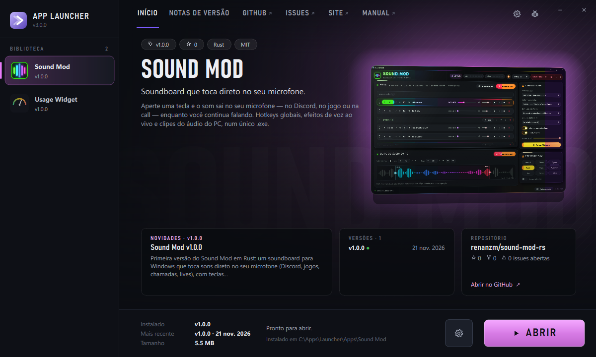
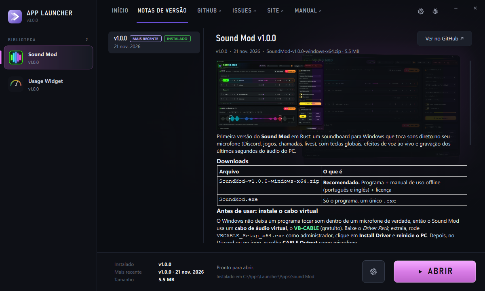
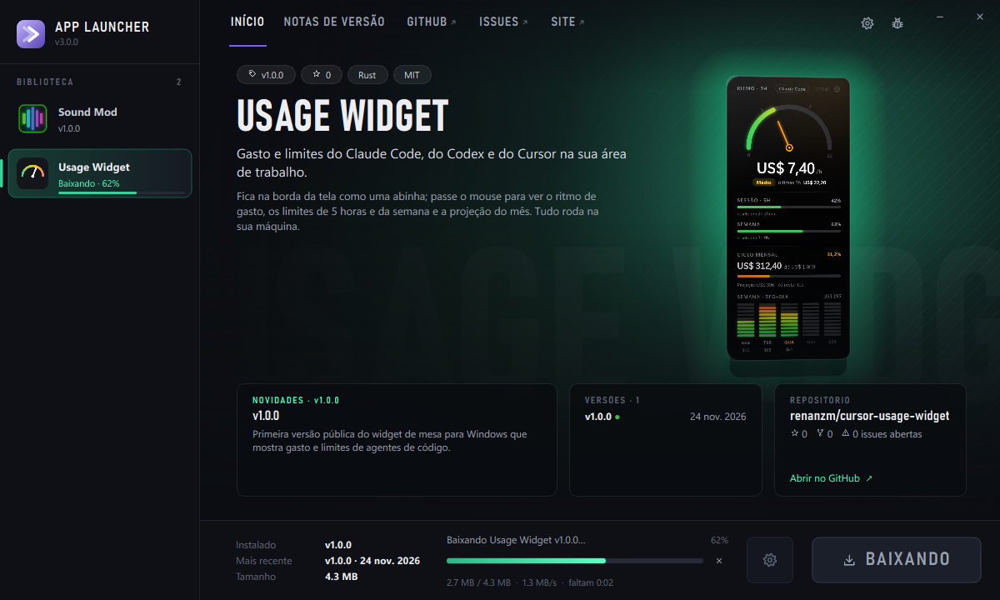

# App Launcher

[English](README.md) · **Português (Brasil)**

Launcher para Windows, no estilo dos launchers de jogos, que **instala, atualiza e executa aplicativos publicados como releases no GitHub** — ou distribuídos por FTP/FTPS. Tudo o que é específico de um ambiente — quais apps, de onde vêm, opções, login — fica num único `launcher_config.json`, então o mesmo executável serve para qualquer conjunto de aplicativos.

Feito em Python + PyQt6: biblioteca de apps à esquerda, a arte e as notas de versão de cada app no centro, um botão grande para abrir embaixo, e todo o trabalho de rede fora da thread da interface. A interface está disponível em **inglês** e **português (Brasil)**.

<p align="center">
  
</p>

## Funcionalidades

- **Releases do GitHub como fonte**: aponte o app para `dono/repo` e o launcher encontra a release mais recente, escolhe o arquivo para Windows (um `.zip` ou um `.exe` único), baixa e instala. Releases novas aparecem sozinhas como atualização.
- **Download seguro**: grava em `.part` e confere o tamanho e o **SHA-256 que o GitHub publica** para cada arquivo antes de instalar qualquer coisa. A extração bloqueia *Zip Slip*, e um zip com tudo dentro de uma única pasta é "achatado".
- **Interface de launcher de jogo**: biblioteca com os ícones reais (tirados do `.exe` instalado), cabeçalho com o banner do app ou um fundo gerado a partir da cor dele mais o screenshot, cartões com novidades, versões recentes e dados do repositório, uma página de **notas de versão** que renderiza o Markdown (com imagens) e links para o GitHub, as issues e o site do projeto.
- **Notas de versão bilíngues**: quando as notas estão em inglês e português, aparece só a parte no idioma da interface.
- **Progresso de loja**: porcentagem, MB baixados, velocidade e tempo restante; o download pode ser cancelado.
- **Atualizações**: de todos os apps instalados ao abrir (opcional) e do próprio launcher, pelas releases dele no GitHub. As consultas usam requisições condicionais (ETag), quase sem gastar o limite da API, e continuam funcionando offline com os últimos dados vistos.
- **Opções por aplicativo** declaradas na configuração (liga/desliga, texto ou senha) que viram variáveis de ambiente do processo iniciado; **ações extras** para outros executáveis do pacote.
- **FTP ou FTPS** continuam suportados, por app, com credenciais cifradas ou remotas, além de downloads avulsos em abas.
- **Login opcional** via HTTP, com "lembrar dados" e entrada automática.
- **Verificar integridade**, **abrir pasta de instalação** e **desinstalar**.
- **Janela nativa** no Windows 11: sombra, cantos arredondados e snap, sem barra de título.
- **Interface em inglês e português (Brasil)**, seguindo o idioma do sistema ou escolhida nas Configurações.

<p align="center">
  
  
</p>

## Começando

Requer Windows e Python 3.11+.

```bash
python -m venv .venv
.venv\Scripts\activate
pip install -r requirements-dev.txt
python -m launcher
```

Sem um `launcher_config.json`, o launcher usa o [`launcher_config.example.json`](launcher_config.example.json), que lista apps publicados no GitHub ([Sound Mod](https://github.com/renanzm/sound-mod-rs) e [Usage Widget](https://github.com/renanzm/cursor-usage-widget)). Os apps são instalados na pasta `Apps`, ao lado do launcher.

Para testar o modo FTP sem um servidor real, suba o servidor de demonstração num terminal e abra o launcher com a configuração de demonstração em outro:

```bash
python -m tools.demo_server
python -m launcher --config tools/demo_config.json
```

Reinicie o servidor com `python -m tools.demo_server --bump` para simular uma versão nova publicada.

## Idioma

O idioma da interface é escolhido nesta ordem:

1. a opção de linha de comando `--lang` (`en` ou `pt-BR`);
2. a opção **Idioma** nas *Configurações* (vale a partir da próxima abertura);
3. a chave `language` do `launcher_config.json`;
4. o idioma do sistema operacional, com inglês como padrão.

Para adicionar outro idioma, crie um catálogo em [`launcher/locales/`](launcher/locales) que associa cada texto em inglês à sua tradução (veja [`pt_br.py`](launcher/locales/pt_br.py)) e registre-o em `LANGUAGES`, em [`launcher/i18n.py`](launcher/i18n.py). Um teste falha se algum texto do código ficar sem tradução ou se sobrar uma entrada que o código não usa mais.

## Configuração

Copie `launcher_config.example.json` para `launcher_config.json` (na pasta do `Launcher.exe`, ou na raiz do projeto ao rodar pelo Python) e ajuste. Também é possível apontar outro arquivo com `--config caminho.json`.

| Chave | Descrição |
|---|---|
| `app_name`, `app_id` | Nome exibido e identificador usado na pasta de estado (`%LOCALAPPDATA%\<app_id>`). |
| `accent_color` | Cor de destaque da interface (`#RRGGBB`). |
| `language` | `auto` (padrão), `en` ou `pt-BR`. |
| `install_root` | Pasta dos apps instalados: relativa ao launcher, absoluta ou com variáveis de ambiente (`%LOCALAPPDATA%\MeusApps`). Padrão: a pasta do launcher. |
| `support_url` | Página aberta pelo botão *Relatar um bug* (oculto se vazio). |
| `github` | Opcional: `token` (repositórios privados ou limite maior de consultas) e `timeout`. |
| `self_update` | `github` (`dono/repo` cujas releases trazem o launcher) **ou** `remote_dir` (FTP), mais `file_name` (padrão `Launcher.exe`). |
| `server` | Só FTP: `protocol` (`ftp`/`ftps`), `host`, `port`, `user`, `password` **ou** `password_enc` + `secret`, `credentials_url`, `encoding`, `timeout`. |
| `auth` | `type: "none"` ou `"http"` (`url`, `title`, `user_label`, `success_contains`, `session_env`). |
| `apps[]` | Ver abaixo. |
| `downloads[]` | Abas de downloads por FTP: `label`, `remote_dir`, `destination`, `extra_files[]` (`name`, `remote_dir`, `badge`). |

### Apps do GitHub

```json
{
  "id": "sound-mod",
  "name": "Sound Mod",
  "github": "renanzm/sound-mod-rs",
  "asset": "SoundMod-*-windows-x64.zip",
  "executable": "SoundMod.exe",
  "accent_color": "#E879F9",
  "tagline": { "en": "A soundboard that plays straight into your microphone.", "pt-BR": "Soundboard que toca direto no seu microfone." },
  "description": "Aparece no cabeçalho; sem ela, vale a descrição do repositório.",
  "screenshot": "https://raw.githubusercontent.com/renanzm/sound-mod-rs/master/docs/screenshot-pt.png",
  "links": [{ "label": "Manual", "url": "https://github.com/renanzm/sound-mod-rs/blob/master/docs/MANUAL.md" }]
}
```

| Chave | Descrição |
|---|---|
| `github` | `dono/repo` (uma URL `https://github.com/...` completa também serve). |
| `asset` | Padrão (glob) do arquivo da release a instalar (`*.exe`, `MeuApp-*-win64.zip`). Sem ele, o launcher escolhe o build portátil para Windows mais provável e ignora instaladores e outras plataformas. |
| `executable` | O `.exe` a abrir, dentro da pasta de instalação. Opcional: num asset `.exe` único é o próprio arquivo; num `.zip`, o launcher acha o executável cujo nome lembra o do app. |
| `prerelease` | `true` oferece também pré-versões. |
| `install_dir` | Pasta dentro de `install_root` (padrão: `name`). |
| `accent_color` | A cor própria do app (cabeçalho, botão, progresso). |
| `tagline`, `description` | Textos do cabeçalho. |
| `banner` | Imagem que preenche o cabeçalho. Sem ela, o cabeçalho é gerado a partir de `accent_color`. |
| `screenshot` | Imagem mostrada com moldura no cabeçalho (ignorada quando há `banner`). |
| `icon` | Ícone na biblioteca. Sem ele, vale o ícone do `.exe` instalado ou as iniciais do app. |
| `links[]` | Links extras na barra superior (`label`, `url`), depois de GitHub, Issues e o site do repositório. |

`tagline`, `description`, `banner`, `screenshot` e os rótulos dos links podem ser um texto ou um objeto com traduções (`{"en": ..., "pt-BR": ...}`). Imagens podem ser URLs (baixadas uma vez e guardadas em cache) ou caminhos relativos ao arquivo de configuração.

Atualizar um app extrai o pacote novo por cima da pasta de instalação, então os arquivos que o app guarda ali são preservados. Se o app estiver aberto, o launcher pede para fechá-lo antes.

### Apps por FTP

```json
{
  "id": "notes",
  "name": "Notes Studio",
  "remote_dir": "/apps/notes",
  "package": "notes.zip",
  "executable": "notes.exe",
  "env": { "NOTES_LAUNCHED_BY": "app-launcher" },
  "extra_actions": [{ "label": "Abrir diagnóstico", "executable": "diagnostics.exe" }],
  "options": [
    { "key": "verbose", "label": "Modo detalhado", "type": "bool", "env": "NOTES_VERBOSE" },
    { "key": "token", "label": "Token da API", "type": "password", "env": "NOTES_TOKEN" }
  ]
}
```

A versão é a data (`MDTM`) e o tamanho (`SIZE`) do pacote; um `<pacote>.sha256` ao lado dele é conferido no download. `env`, `extra_actions` e `options` valem também para apps do GitHub.

Opções `bool` ligadas viram `"1"` e desligadas removem a variável; opções de texto vazias também removem a variável, para o aplicativo nunca herdar um valor antigo do ambiente. Opções `password` são guardadas cifradas.

### Login HTTP

Com `auth.type = "http"`, o launcher envia `POST {"username": ..., "password": ...}` para `auth.url`. A resposta é aceita quando é 2xx e (se `success_contains` estiver definido) contém aquele texto; 401/403 contam como credenciais inválidas. `session_env` repassa usuário e senha ao aplicativo iniciado:

```json
"auth": {
  "type": "http",
  "url": "https://auth.example.com/login",
  "session_env": { "user": "APP_USER", "password": "APP_PASSWORD" }
}
```

### Senha cifrada e credenciais remotas (FTP)

Para não deixar a senha do servidor em texto puro:

```bash
python -m tools.encrypt_password --new-secret
```

O comando imprime o `secret` (vai em `server.secret`) e o `password_enc`. O esquema (PBKDF2-HMAC-SHA256 + keystream SHA-256 + HMAC, só stdlib) está descrito em [`launcher/crypto.py`](launcher/crypto.py). É ofuscação com integridade: protege um JSON acessível por link, mas quem tem o `secret` consegue decifrar.

Com `server.credentials_url`, as credenciais (`host`, `port`, `user`, `password`/`password_enc`) vêm de um JSON remoto a cada conexão; trocar a senha do servidor não exige redistribuir o launcher. A última resposta válida fica em cache, cifrada com a DPAPI do Windows, para o launcher continuar funcionando se a URL ficar fora do ar.

## Publicando

**GitHub**: crie uma release com o `.zip` ou o `.exe` do app anexado. O GitHub calcula o SHA-256 de cada arquivo, e o launcher confere. O launcher se atualiza do mesmo jeito: publique uma release do repositório de `self_update.github` com o `Launcher.exe` anexado e uma tag mais nova que a versão em uso (`v3.1.0` > `3.0.0`).

**FTP**:

```
/apps/notes/
    notes.zip                 ← pacote oficial (package)
    notes.zip.sha256          ← opcional: hash verificado no download
/launcher/
    Launcher.exe              ← publicado para a auto-atualização
```

Para gerar o `.sha256`: `certutil -hashfile notes.zip SHA256` ou `sha256sum notes.zip > notes.zip.sha256`. Envie o `Launcher.exe` em modo **binário** — o modo ASCII altera o tamanho do arquivo e as máquinas nunca reconhecem a versão como instalada.

## Onde ficam os dados

- **Aplicativos instalados**: em `install_root` (por padrão, a pasta do launcher), uma pasta por app.
- **Estado** (preferências, versões instaladas, opções): `%LOCALAPPDATA%\<app_id>\state.json`. Senha lembrada, opções do tipo senha e credenciais em cache ficam cifradas com DPAPI — só o mesmo usuário do Windows consegue lê-las.
- **Cache** (respostas do GitHub e imagens): `%LOCALAPPDATA%\<app_id>\cache` — pode ser apagado à vontade.

## Arquitetura

```
launcher/
  config.py        leitura e validação do launcher_config.json
  github.py        releases do GitHub: cache com ETag, escolha do arquivo, download verificado
  remote.py        FTP/FTPS, credenciais, listagem, download com verificação
  sources.py       uma interface única para as duas fontes; utilitários de notas de versão
  installer.py     extração segura, apps de um .exe só, ambiente de execução
  auth.py          login opcional e credenciais lembradas
  self_update.py   troca do próprio .exe
  state.py         estado em JSON + DPAPI
  crypto.py        cifra do password_enc
  i18n.py          busca de traduções (texto-fonte em inglês)
  locales/         catálogos de tradução (pt_br.py)
  ui/              PyQt6: janela principal, biblioteca, palco (cabeçalho + notas de versão),
                   barra de ação, arte e ícones desenhados em código, moldura nativa, diálogos
tools/             servidor e config de demonstração FTP, gerador de ícone e de senha cifrada
tests/             testes unitários e de integração (API do GitHub simulada, servidor FTP real em thread)
```

Os módulos fora de `ui/` não dependem de Qt e são cobertos pelos testes. Na interface, toda operação de rede roda em `QThread` (`ui/widgets.py: Task`), então a janela nunca congela durante downloads.

## Testes

```bash
python -m unittest discover -s tests -v
```

A suíte roda no GitHub Actions (`windows-latest`) a cada push e pull request.

## Build do executável

```bash
build.bat
```

Gera `dist\Launcher.exe` com PyInstaller (`Launcher.spec`). Distribua o `.exe` junto com o seu `launcher_config.json` (ou use o exemplo embutido). O ícone (`assets/app.ico`) é gerado a partir da marca desenhada em código: `python -m tools.make_icon --accent "#7C5CFF"`.

## Licença

[MIT](LICENSE)
